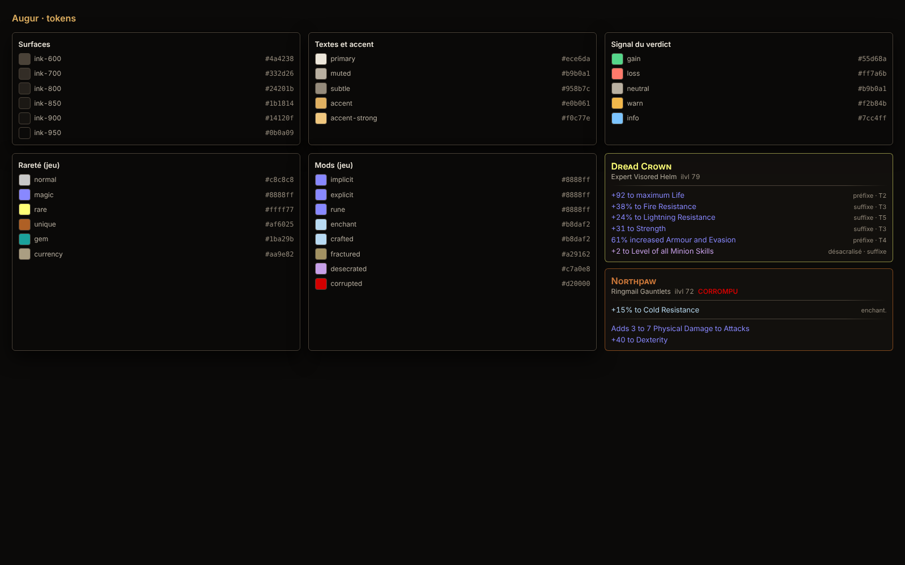

# Design system Augur « dark » (V1)

**Statut :** V1 du sprint 1, à confirmer sur captures réelles du jeu (voir « À vérifier »).
**Code :** `packages/ui` (`@augur/ui`). Bac à sable : `pnpm dev:ui`, puis `?view=tokens` et `?view=updates`.

## Principes

1. **Lisible par-dessus le jeu.** L'overlay se pose sur des zones très sombres comme très claires (neige, désert, effets de sorts). Fond opaque à 94 %, bordure et ombre marquées. WebView2 ne floute pas ce qui est derrière la fenêtre : on ne compte pas sur un effet de verre.
2. **La couleur ne porte jamais seule l'information.** Chaque delta a un signe (`+`, `−`, `±`) et une flèche (▲ ▼ ●) ; chaque niveau de confiance a un pictogramme et un mot.
3. **Fidèle aux conventions du jeu** pour les objets (raretés, types de mods), **sobre** pour le reste : un seul accent (l'or d'augure), réservé aux actions et au focus.
4. **Honnête sur l'incertitude.** « Vérifié », « approximatif », « non supporté » sont visibles en permanence ; un prix ancien affiche son âge ; une file de rate limit est montrée, pas cachée.
5. **Polices système Windows** (Segoe UI Variable, Cascadia Mono) : aucune police embarquée, aucun téléchargement.

## Tokens

La source de vérité est `packages/ui/src/styles/tokens.ts` ; `tokens.css` en est le miroir Tailwind 4 (`@theme`). Le test `tokens.test.ts` échoue si les deux divergent ou si un contraste passe sous le seuil.

### Surfaces et textes

| Token | Valeur | Usage |
|---|---|---|
| `ink-950` | `#0b0a09` | Fond de l'overlay (à 94 %) et de la fenêtre principale |
| `ink-900` / `ink-850` / `ink-800` | `#14120f` / `#1b1814` / `#24201b` | Cartes, champs, puces |
| `ink-700` / `ink-600` | `#332d26` / `#4a4238` | Séparateurs, bordures |
| `text-primary` | `#ece6da` | Texte principal |
| `text-muted` | `#b9b0a1` | Libellés |
| `text-subtle` | `#958b7c` | Métadonnées (âge d'un prix, ilvl) |
| `accent` / `accent-strong` | `#e0b061` / `#f0c77e` | Actions, focus, « DPS par exalt » |

### Signal du verdict

| Token | Valeur | Sens |
|---|---|---|
| `signal-gain` | `#55d68a` | Hausse, « vérifié » |
| `signal-loss` | `#ff7a6b` | Baisse, alerte, « non supporté » |
| `signal-warn` | `#f2b84b` | Compromis, approximatif, prix ancien, rate limit |
| `signal-info` | `#7cc4ff` | Information, valeur « mesurée » |
| `signal-neutral` | `#b9b0a1` | Écart non significatif (< 1 %) |

### Conventions du jeu

| Rareté | Valeur | Mods | Valeur |
|---|---|---|---|
| Normal | `#c8c8c8` | Implicite, explicite, rune | `#8888ff` |
| Magique | `#8888ff` | Enchantement, crafté | `#b8daf2` |
| Rare | `#ffff77` | Fracturé | `#a29162` |
| Unique | `#af6025` (bordures) / `#d07a3a` (texte) | Désacralisé | `#c7a0e8` *(à vérifier)* |
| Gemme | `#1ba29b` | Corrompu | `#d20000` (gras uniquement) |
| Devise | `#aa9e82` | | |

**Écart assumé :** l'orange unique du jeu (`#af6025`) n'atteint que 3,5:1 sur nos surfaces. Le texte des uniques utilise une variante éclaircie (`rarity-unique-text`, 5:1), la couleur exacte reste sur les bordures. Même logique pour le rouge « Corrompu » du jeu : conservé, mais seulement en gras et en capitales.

## Contrastes vérifiés (test automatique)

Tous les textes, signaux, raretés et l'accent atteignent **4,5:1 (WCAG AA)** sur trois fonds : `ink-950`, `ink-800`, et l'overlay posé sur une zone blanche (cas le plus défavorable de la transparence à 94 %).

## Typographie

| Token | Taille / interligne | Usage |
|---|---|---|
| `text-2xs` | 11 / 14 px | Métadonnées, aides clavier |
| `text-xs` | 12 / 16 px | Libellés secondaires |
| `text-sm` | 13 / 18 px | Lignes de stats, mods |
| `text-base` | 14 / 20 px | Texte courant, DPS et EHP |
| `text-lg` | 16 / 22 px | Nom d'objet (petites capitales), prix |
| `text-verdict` | 30 / 34 px | Delta de DPS |

Chiffres tabulaires partout (`font-feature-settings: "tnum"`), nombres au format français (`48 210`, `+12,4 %`, espace fine insécable avant `%` et les unités).

## Échelle et mouvement

- `--augur-scale` (0,9 à 1,5) agrandit tout l'overlay pour la 1440p et la 4K ; réglage utilisateur prévu.
- Animations de 120 ms maximum, désactivées par `prefers-reduced-motion`.

## Composants (`@augur/ui`)

| Composant | Rôle |
|---|---|
| `CopilotOverlay` | Vue complète de l'overlay, un rendu par état de `CopilotView` |
| `DeltaPanel` | Verdict, delta DPS/EHP, résistances, Spirit, alertes, mécaniques à confirmer |
| `PriceTag`, `RateLimitNotice` | Prix médian, fourchette, source, âge ; file et restriction GGG |
| `ItemTooltip`, `ItemHeader` | Objet fidèle aux conventions du jeu, partagé avec le planificateur |
| `SupportBadge` | Vérifié / Approximatif / Non supporté |
| `StatePanel`, `Kbd`, `Icon` | États non nominaux, touches, pictogrammes |
| `UpdateBanner` | Mise à jour de l'application |

## À vérifier sur captures réelles (UX, S2)

- Couleurs des mods désacralisés et des runes en PoE 2.
- Lisibilité sur 10 captures réelles : 5 zones claires, 5 sombres, en 1080p et 1440p.
- Libellés de l'en-tête du presse-papier d'un client français (`Classe d'objet`, `Rareté`).
