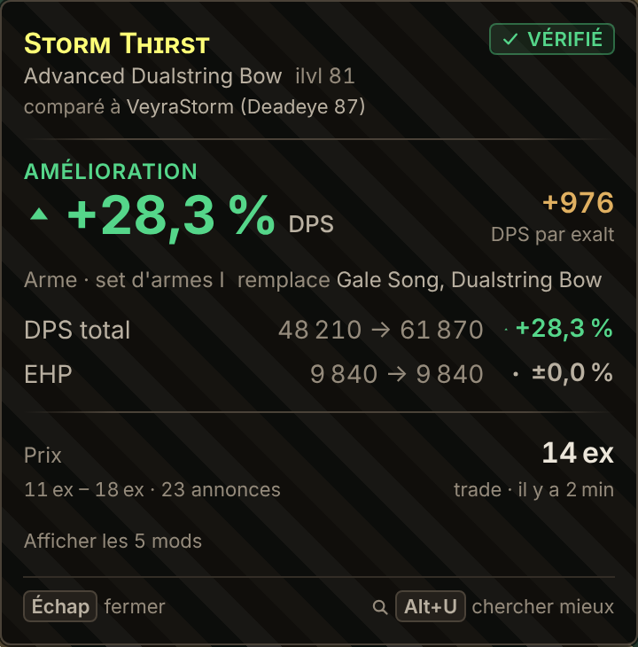
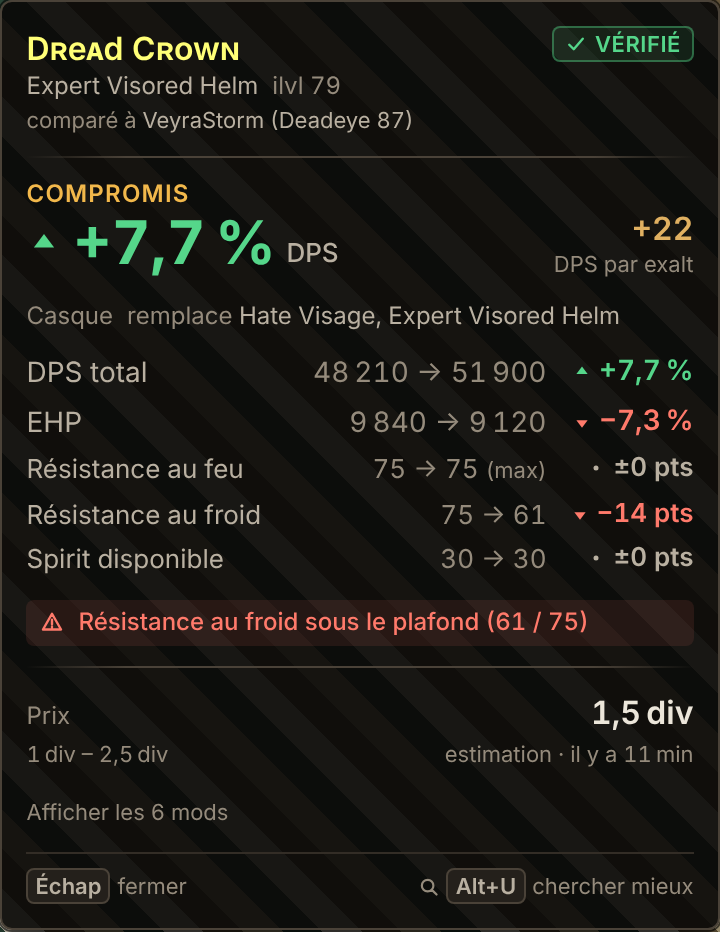
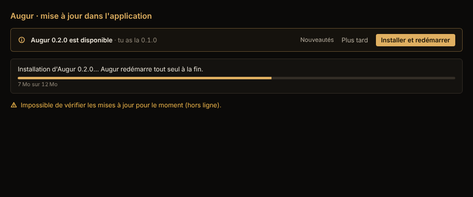

# Spec des écrans de l'overlay Upgrade Copilot (V0)

**Question à laquelle l'overlay répond, en moins d'une seconde de lecture :** *cet objet améliore-t-il MON personnage, de combien, et pour quel prix ?*
**Maquettes interactives :** `pnpm dev:ui` (données fictives). Design system : [design-system.md](design-system.md).

| Amélioration | Compromis avec alerte |
|---|---|
|  |  |

Tous les états sur fond sombre, clair et chargé : [sombre](maquettes/overlay-etats-fond-sombre.png), [clair](maquettes/overlay-etats-fond-clair.png), [chargé](maquettes/overlay-etats-fond-charge.png).

## 1. Déclenchement et cycle de vie

1. Le joueur fait **Ctrl+C** sur un objet en jeu (sol, coffre, trade). Le jeu copie le texte de l'objet ; Augur n'envoie **aucune touche** au jeu.
2. Augur voit le presse-papier changer, vérifie que la fenêtre au premier plan est **Path of Exile 2** et que le texte est un objet.
3. L'overlay apparaît **à droite du curseur** (24 px d'écart pour ne pas masquer le tooltip du jeu), bascule à gauche près du bord droit, reste dans l'écran courant (multi-écrans gérés).
4. Il **ne prend jamais le focus** : le clavier reste au jeu, même quand on clique dans l'overlay (`WS_EX_NOACTIVATE`).
5. Il se ferme quand le curseur s'éloigne de plus de 360 px hors du panneau, sur **Échap**, ou au clic sur « fermer ».
6. La fenêtre épouse la taille du panneau : aucune zone transparente ne capte les clics destinés au jeu.

**Prérequis joueur :** jeu en « fenêtré sans bordure » (le plein écran exclusif masque tout overlay). À expliquer dans l'onboarding.

## 2. Raccourcis

| Touche | Action | Quand |
|---|---|---|
| Ctrl+C (jeu) | Ouvre l'overlay | Toujours (c'est la copie native du jeu) |
| Échap | Ferme l'overlay | **Seulement pendant l'affichage**, sinon la touche reste au jeu |
| Alt+U | Recherche d'un meilleur objet sous budget (sprint 3) | Seulement pendant l'affichage |

Une pression = une action au plus. Aucune macro, aucune répétition.

## 3. Anatomie du panneau (360 px à l'échelle 1)

1. **En-tête** : nom (couleur de rareté, petites capitales), base, ilvl, « Corrompu » ; badge de prise en charge à droite ; « comparé à *Personnage (Classe niveau)* ».
2. **Verdict** : mot (Amélioration, Régression, Compromis, Équivalent) + **delta de DPS en grand**, avec flèche et signe. « ≈ » devant le chiffre si le calcul est approximatif. À droite : **DPS par exalt** (sur le prix médian) quand le gain est positif et le prix connu.
3. **Contexte** : emplacement, set d'armes I/II, « remplace *objet équipé* ».
4. **Détail** : DPS total, EHP (en %), puis résistances et Spirit (en points), avec avant → après et « (max) » au plafond.
5. **Alertes** : toute résistance qui **passe sous son plafond** (bandeau rouge). C'est l'erreur la plus coûteuse en jeu.
6. **Mécaniques à confirmer** : notes « mesuré » / « supposé » venues des fiches du Theorycrafter.
7. **Prix** : médiane, fourchette, nombre d'annonces, source (trade, échange de devises, estimation), âge. Prix ancien (`stale`) en orange avec horloge.
8. **Mods** : repliés par défaut (le jeu les montre déjà), dépliables.
9. **Pied** : aides clavier.

**Règles de verdict** (`packages/ui/src/lib/verdict.ts`) : un écart sous 1 % est « stable ». Amélioration = rien ne baisse et au moins une hausse ; Régression = l'inverse ; Compromis = DPS et EHP vont dans des sens opposés.

## 4. États

| État | Déclencheur | Ce qu'on montre | Ce qu'on ne montre pas |
|---|---|---|---|
| Amélioration / Régression / Compromis / Équivalent | Évaluation réussie, archétype vérifié | Panneau complet | |
| Approximatif | `support = approximate` | Badge orange, « ≈ » devant le DPS, liste des mécaniques non confirmées | |
| Non supporté | `support = unsupported` | Message clair, prix conservé | **Aucun chiffre de DPS/EHP** : mieux vaut rien qu'un chiffre faux |
| Analyse en cours | Calcul > 150 ms | En-tête de l'objet + squelette animé | Rien sous 150 ms (pas de clignotement) |
| Prix en file | Rate limiter local | « 2 recherches en file, lancées dès que le site de trade le permet » | |
| Limite GGG atteinte | `blockedForMs` / `Retry-After` | Décompte « reprise dans 58 s » | Aucune nouvelle requête avant la fin |
| Prix indisponible | Pas assez d'annonces | Phrase explicative | Prix inventé |
| Aucun personnage | Pas d'import | En-tête + invitation à importer (OAuth ou code PoB) | Delta |
| Objet non reconnu | Échec du parseur | Message + code d'erreur (pour le signalement) | |
| Copilot en pause | Kill switch distant | Raison en une phrase, « rien à faire de ton côté » | |
| Prix coupé | Kill switch `tradePriceCheck` | Panneau sans bloc prix | |

## 5. Contrat utilisé

Types de `@augur/contracts` (chantier Architecture), recopiés en miroir dans `packages/ui/src/types.ts` jusqu'à la fusion. Le modèle de vue `CopilotView` est propre à l'interface.

- Commandes : `parse_clipboard_item`, `get_overlay_state`, `evaluate_item`, `estimate_price`, plus `hide_overlay` et `fit_overlay` (fenêtre).
- Événements : `augur://item-copied`, `augur://zone-changed`, `augur://overlay-hidden`, `augur://upgrade-search-requested`, `augur://rate-limit-changed`, `augur://feature-flags-changed`.
- Enchaînement : `apps/desktop/src/overlay/copilot.ts` (testé).

## 6. Mise à jour de l'application

Bandeau discret dans la fenêtre principale, jamais dans l'overlay ni en modal : version disponible, nouveautés dépliables, « Installer et redémarrer » / « Plus tard », barre de progression. Vérification au démarrage puis toutes les 6 h, et via « Rechercher des mises à jour » (fenêtre et menu de la zone de notification). Option « Rejoindre la bêta ». Rien ne s'installe sans un clic du joueur.

## 7. Questions ouvertes (S1 à S3)

- Entretiens joueurs (S1) : position préférée (près du curseur ou ancrée sur un bord), et faut-il un mode « compact » (verdict seul) pour le farm en map ?
- Réglage de l'échelle (0,9 à 1,5) et des raccourcis dans la fenêtre principale.
- Comparaison à deux emplacements (anneaux, sets d'armes) : un onglet par emplacement ou le meilleur des deux ?
